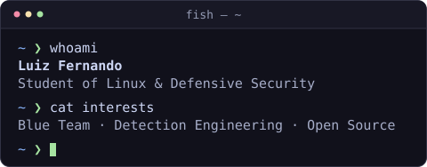

  

  
  
  

### `~ ❯ about`

I enjoy understanding how systems work, experimenting with technology and learning through hands-on projects.

### `~ ❯ learning`

- Computer networking
- Linux & security fundamentals
- Security operations (SOC)

### `~ ❯ projects`

**[clipcut](https://github.com/Luiz-Wendland/clipcut)**  
An open-source desktop video editor for Linux and Windows, developed with AI assistance.

**[medusa-authentication-lab](https://github.com/Luiz-Wendland/bootcamp-santander-ciberseguranca/tree/main/medusa-authentication-lab)**  
A controlled lab covering FTP and SMB authentication testing, log analysis and mitigation.

**[dio-agent-security](https://github.com/Luiz-Wendland/bootcamp-santander-ciberseguranca/tree/main/dio-agent-security)**  
Customizing an AI agent for vulnerability analysis and security education.

### `~ ❯ environment`

### `~ ❯ activity`

