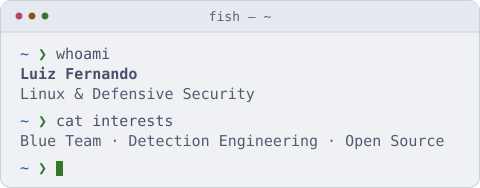

<picture>
  <source media="(prefers-color-scheme: dark)" srcset="assets/terminal-dark.svg">
  
</picture>

<pre><strong>luiz@linux ~&gt; ls ~/projects</strong>
<a href="https://github.com/Luiz-Wendland/clipcut">clipcut/</a>
  Local video clip editor built with PySide6.
<a href="https://github.com/Luiz-Wendland/bootcamp-santander-ciberseguranca">bootcamp-santander-ciberseguranca/</a>
  Projects from the Santander Cybersecurity Bootcamp.

<strong>luiz@linux ~&gt; ▋</strong></pre>
